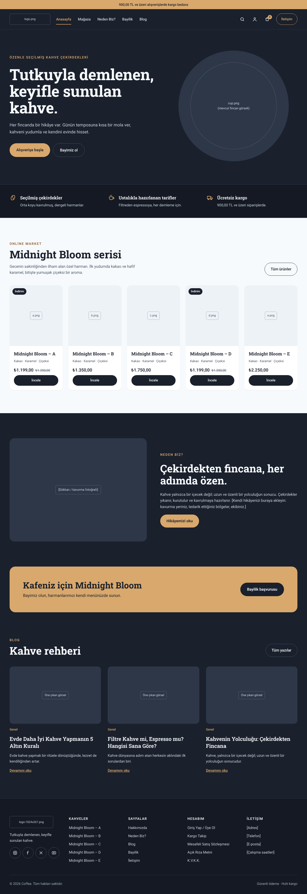
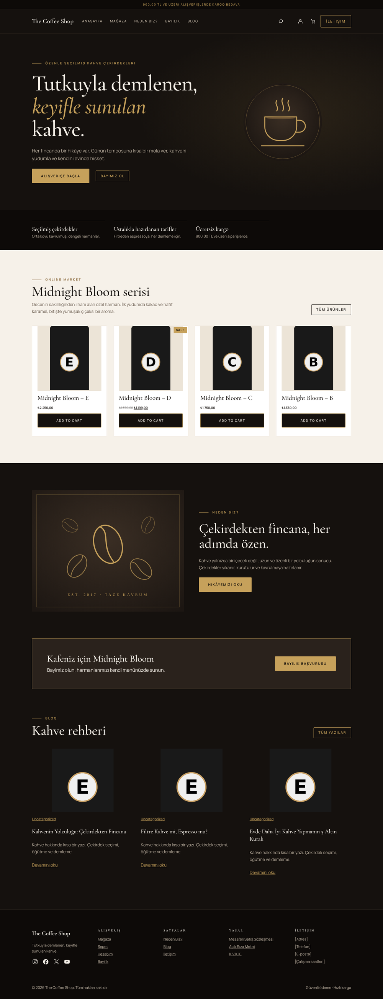
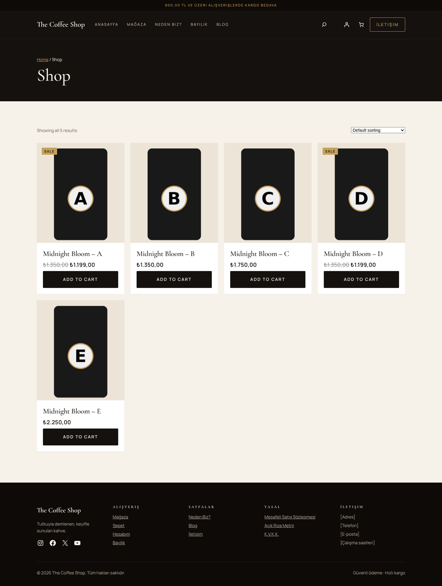
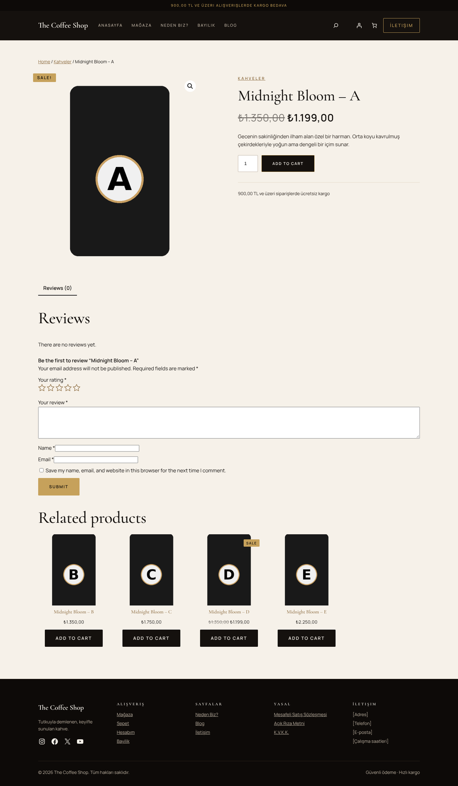

# Coffee: WordPress coffee shop redesign

An open source redesign of **Coffee**, a WordPress + WooCommerce coffee shop site (Kadence theme, Elementor). This repo has the full process, from inspecting the live site to a clickable 10-page mockup that you can download and open in any browser.



**New here? Read the [Setup guide](SETUP-GUIDE.md)** for screenshots of every page and step-by-step WordPress instructions.

## Install the WordPress theme

The `theme/coffee-shop` folder is a free block theme built from the mockups. It needs WordPress 6.6 or newer. WooCommerce and Contact Form 7 are recommended.

1. [Download `coffee-shop.zip`](https://github.com/fatihborasoftware-sudo/Coffee-Shop-Free-Theme/raw/main/dist/coffee-shop.zip), the ready-to-upload theme. You can also build it yourself with `./tools/build-theme-zip.sh`.
2. In WordPress, go to **Appearance → Themes → Add New → Upload Theme**, choose `coffee-shop.zip`, then click **Activate**.
3. Follow [Part 2 of the setup guide](SETUP-GUIDE.md#part-2-building-it-in-wordpress) to create the pages and products.

| Home | Shop | Product |
|---|---|---|
|  |  |  |

### The premium look (0.2.0)

Version 0.2.0 moves the theme from the original slate and caramel to a darker, more upscale roastery look:

| Token | Value | Use |
|---|---|---|
| Espresso (`ink`) | `#15110E` | Site background |
| Deep espresso (`deep`) | `#0D0A08` | Top bar, value strip, footer |
| Roast (`surface`) | `#2A221C` | Cards on dark sections |
| Cream (`light`) | `#F6F1E9` | Shop and product sections |
| Gold (`caramel`) | `#C6A15B` | Buttons, hairlines, eyebrows, italic accents |
| Display font | Cormorant Garamond 500/600 + italic | Headings |
| Body font | Manrope 400 to 600 | Everything else, uppercase letter-spaced for buttons and menu |

Buttons are square with letter-spaced capitals, section eyebrows get a short gold rule, and the photo placeholders are replaced by framed gold illustrations (`assets/images/beans.svg`, `beans-wide.svg`, `cup.svg`) until you add your own photos. The palette slugs did not change, so pages built with 0.1 pick up the new look without edits.

## Quick start (mockups)

1. Download this repo (**Code → Download ZIP**) or clone it.
2. Open `mockup/index.html` in your browser.
3. Click through the menu: every page links to the others.

There's no build step and nothing to install.

## Pages

| Page | File | What's on it |
|---|---|---|
| Anasayfa (Home) | `mockup/index.html` | Hero, value strip, product grid, Neden Biz, dealer banner, blog |
| Mağaza (Shop) | `mockup/shop.html` | Filter chips, sorting, 5 products with sale badges |
| Ürün (Product) | `mockup/product.html` | Gallery, price, tasting notes, grind picker, quantity, tabs, related products |
| Sepet (Cart) | `mockup/cart.html` | Line items, free shipping progress bar, order summary |
| Hesabım (Account) | `mockup/account.html` | Login / sign up |
| Neden Biz? / Hakkımızda | `mockup/about.html` | Bean-to-cup steps, brand story |
| Bayilik (Dealer) | `mockup/dealer.html` | Benefits and an application form |
| İletişim (Contact) | `mockup/contact.html` | Contact cards, form, map slot |
| Blog | `mockup/blog.html` | Featured post, categories, post grid |
| Blog yazısı (Post) | `mockup/post.html` | Article layout with a product callout |

Text in `[brackets]` and dashed boxes are placeholders for your own content and images.

## How it was made: the steps

### 1. Inspect the existing site
The live site was read page by page: the homepage, Blog, Neden Biz?, Mağaza, Hesabım and Site Haritası. We captured:
- **Stack:** Kadence theme, Elementor 4.3.5, WooCommerce, Jetpack.
- **Content:** every Turkish heading, button, product name and price, blog post, and footer link.
- **Images:** `logo.png`, `logo-1024x267.png`, `cup.png`, product images `a.png` to `e.png` (under `wp-content/uploads/2026/01/`).
- **Gaps:** the "Neden Biz?" page was lorem ipsum, and "Hakkımızda" and "İletişim" had no pages. The site also had no address, phone number or opening hours.

### 2. Pull out the brand
From the Elementor kit stylesheet (`wp-content/uploads/elementor/css/post-6.css`):

| Token | Value | Use |
|---|---|---|
| Ink (background) | `#1A202C` | Kadence palette 3, site background, `theme-color` |
| Surface | `#2D3748` | Cards on dark sections |
| Deep | `#141923` | Value strip, footer |
| Muted text | `#CBD5E0` | Body text on dark |
| Light | `#F7FAFC` / `#EDF2F7` | Shop and product sections |
| **Caramel accent** (new) | `#D9A86C` | Buttons, highlights, top bar |
| Display font | Roboto Slab 600/700 | Headings |
| Body font | Roboto 400/500 | Everything else |

The Elementor global colors (`#6EC1E4`, `#61CE70`…) were untouched defaults, so they were left out. The only new color is the caramel accent.

### 3. Redesign the homepage
- One clear hero headline instead of the repeated "Tutkuyla Demlenen," blocks
- A light product section so the Midnight Bloom bags stand out
- A dealer ("Bayimiz ol") banner, which was only a button before
- A simpler menu: Anasayfa, Mağaza, Neden Biz?, Bayilik, Blog, plus icons for search, account and cart

### 4. Design the rest of the pages
Every page shares one header (`Header.dc.html`) and one footer (`Footer.dc.html`) so they stay consistent.

### 5. Export to plain HTML
The design was built on a Claude design canvas as `.dc.html` components (in `design-source/`). `tools/convert.js` renders each one into a standalone HTML page in `mockup/`:

```bash
npm install jsdom@24.1.3
node tools/convert.js design-source mockup
```

The exported pages are static snapshots. The interactive bits from the canvas (filters, quantity steppers, form thank-you states) show their default state.

## Next steps
- Add the real images (logo, cup, products) and fill in the `[bracketed]` placeholders.
- Rebuild the pages in WordPress with Kadence + Elementor, using the tokens above as the Elementor global colors and fonts.

## License
MIT. See [LICENSE](LICENSE).
