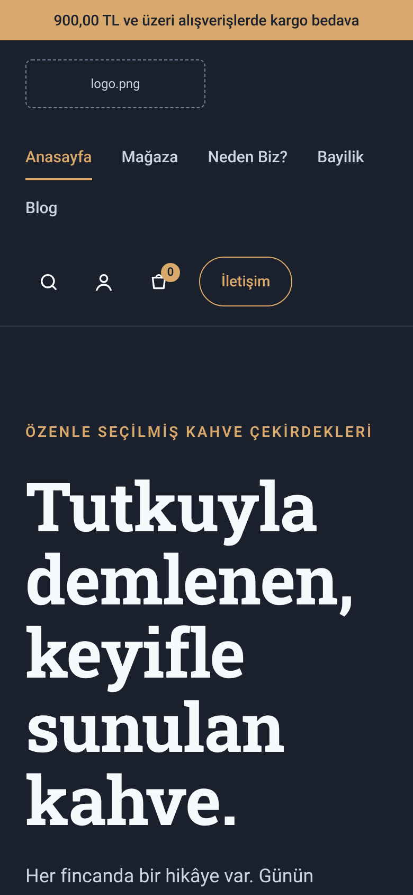
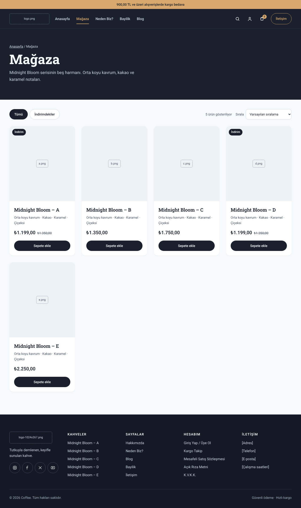
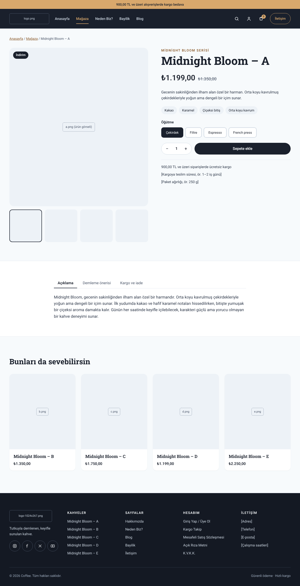
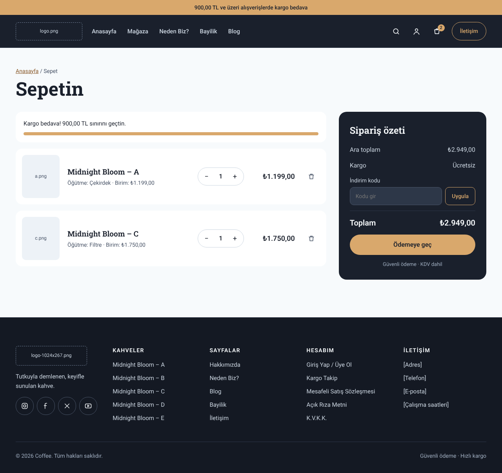
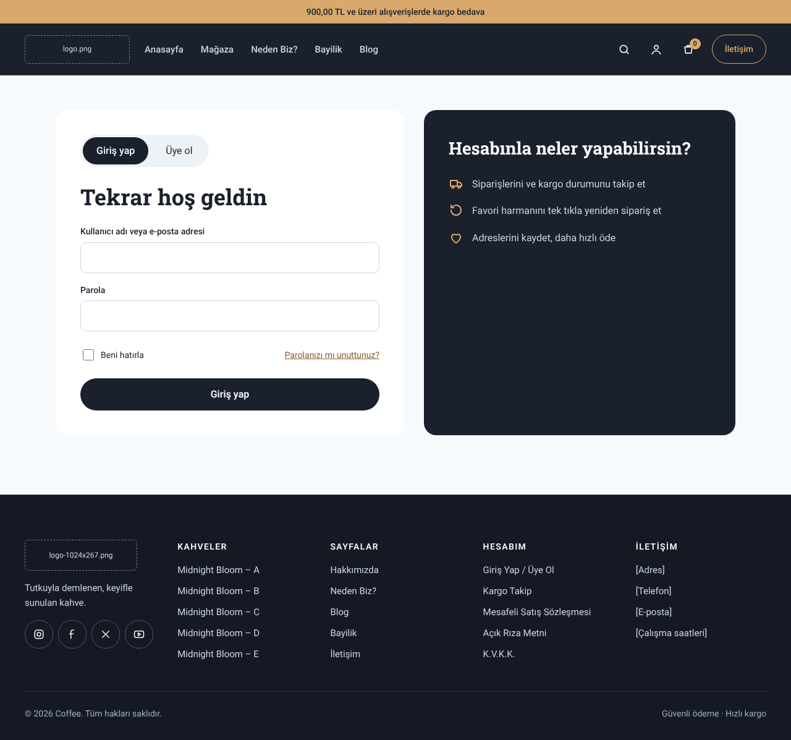
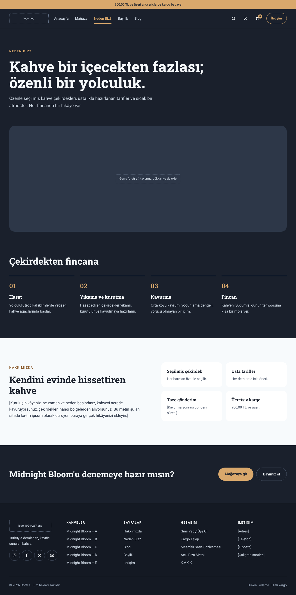
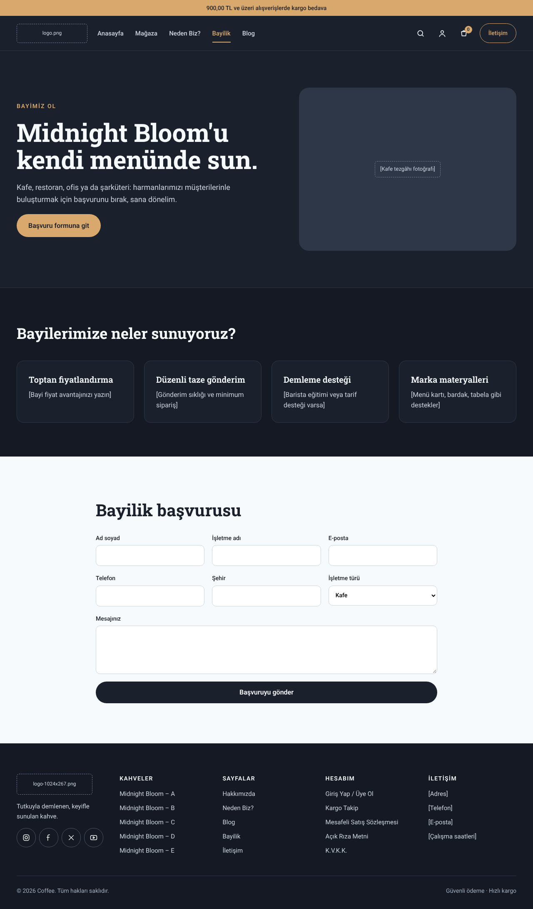
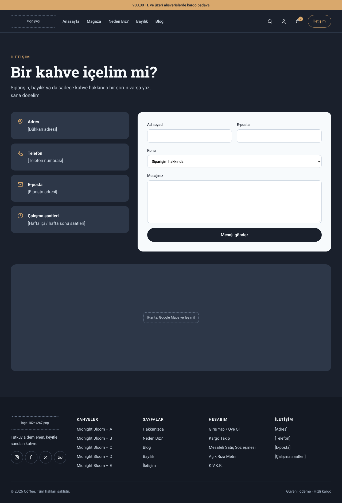
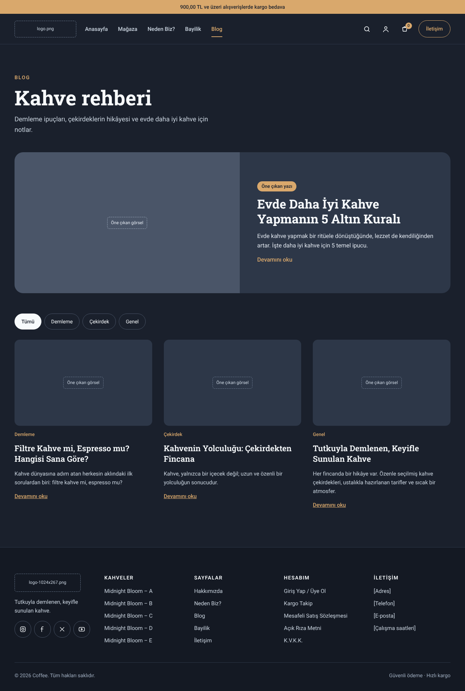
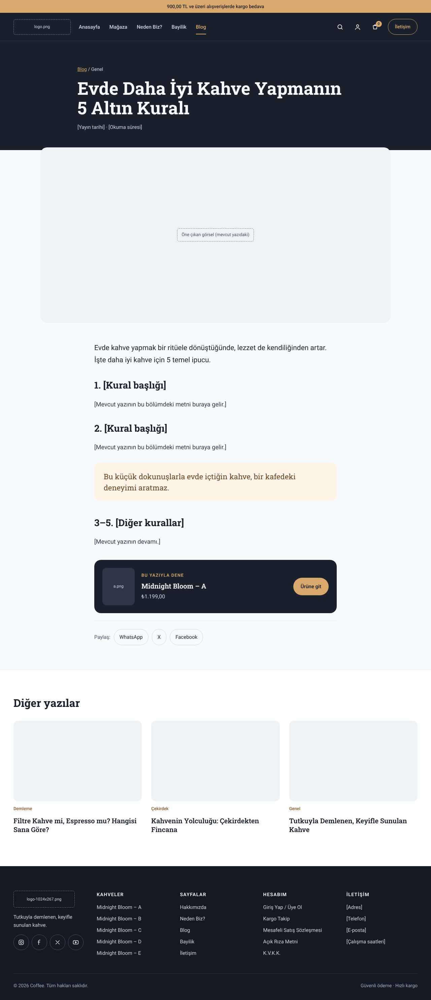

# Setup guide

This guide has two parts:

1. **[The mockups](#part-1-the-mockups)**: every page of the redesign, so you know what you're building.
2. **[Building it in WordPress](#part-2-building-it-in-wordpress)**: step by step, using the free Kadence theme, Elementor and WooCommerce.

To click through the mockups yourself, open [`mockup/index.html`](mockup/index.html) in a browser.

> Dashed boxes are image slots (logo, cup, product photos) and text in `[brackets]` is content you fill in.

---

## Part 1: The mockups

### Brand at a glance

| Token | Value | Where it's used |
|---|---|---|
| Ink | `#1A202C` | Main background, header, dark buttons |
| Deep | `#141923` | Value strip, footer |
| Surface | `#2D3748` | Cards and image slots on dark sections |
| Border | `#4A5568` | Outline buttons on dark |
| Muted text | `#CBD5E0` | Body text on dark |
| Light | `#F7FAFC` | Shop, product and cart backgrounds |
| Light 2 | `#EDF2F7` | Product image backgrounds, chips |
| Caramel | `#D9A86C` | Accent: main buttons, top bar, highlights |
| Brown | `#8A5A2B` | Accent text on light backgrounds |
| Headings | **Roboto Slab** 600 / 700 | |
| Body | **Roboto** 400 / 500 | |

Buttons are fully rounded (pill shape), cards use a 16px radius, and content sits in a 1200px container.

### 1. Anasayfa (Home): `mockup/index.html`
Top bar with free shipping message → header → hero (headline, two buttons, cup image) → value strip (three benefits) → Midnight Bloom product grid → Neden Biz? teaser → dealer banner → three latest blog posts → footer.

On a phone the menu wraps and every section stacks into one column:

### 2. Mağaza (Shop): `mockup/shop.html`
Dark title band → filter chips (Tümü / İndirimdekiler) and a sort menu → product grid with sale badges and "Sepete ekle" buttons.

### 3. Ürün (Product): `mockup/product.html`
Image gallery with thumbnails → name, price and old price, tasting note chips, grind picker, quantity stepper, add to cart → tabs (Açıklama, Demleme önerisi, Kargo ve iade) → related products.

### 4. Sepet (Cart): `mockup/cart.html`
Free shipping progress bar → line items with quantity and remove buttons → dark order summary with a coupon field and checkout button.

### 5. Hesabım (Account): `mockup/account.html`
Login and sign up tabs on the left, account benefits on the right.

### 6. Neden Biz? / Hakkımızda: `mockup/about.html`
Big headline → wide photo → four "Çekirdekten fincana" steps → brand story with four value cards → call to action.

### 7. Bayilik (Dealer): `mockup/dealer.html`
Hero → four dealer benefits → application form.

### 8. İletişim (Contact): `mockup/contact.html`
Address, phone, email and hours cards → contact form → map slot.

### 9. Blog: `mockup/blog.html`
Title → featured post → category chips → post grid.

### 10. Blog yazısı (Post): `mockup/post.html`
Dark title band → featured image → article with a pull quote and a product callout → share buttons → more posts.

---

## Part 2: Building it in WordPress

These steps assume a fresh WordPress install. Everything used here is free.

### Step 1: Back up first
If you're redesigning an existing site, take a full backup before changing anything (for example with the free **WPvivid Backup** plugin).

### Step 2: Install the theme and plugins
1. **Appearance → Themes → Add New** → search **Kadence** → Install → Activate.
2. **Plugins → Add New**, then install and activate:
   - **Elementor** (page builder)
   - **WooCommerce** (shop, cart, account)
   - **Contact Form 7** (or any form plugin you like) for the contact and dealer forms

### Step 3: Set the brand colors and fonts
**Kadence:** go to **Appearance → Customize → Colors & Fonts → Global Palette** and set:

| Palette slot | Color |
|---|---|
| 1 (accent) | `#D9A86C` |
| 2 (accent alt) | `#8A5A2B` |
| 3 (strongest text) | `#1A202C` |
| 4 (strong text) | `#2D3748` |
| 5 (medium text) | `#4A5568` |
| 6 (subtle text) | `#718096` |
| 7 (subtle background) | `#EDF2F7` |
| 8 (light background) | `#F7FAFC` |
| 9 (white) | `#FFFFFF` |

Under **Typography**, set the base font to **Roboto** and headings to **Roboto Slab**.

**Elementor:** open any page in Elementor → **Site Settings → Global Colors** and set Primary `#1A202C`, Secondary `#2D3748`, Text `#4A5568`, Accent `#D9A86C`. Then go to **Global Fonts** and set Primary and Secondary to Roboto Slab, and Text and Accent to Roboto. This replaces Elementor's default blue and green.

### Step 4: Upload your images
**Media → Add New**: your logo (light version for the dark header), the cup image, product photos, and blog featured images.

### Step 5: Create the pages
**Pages → Add New** for each of these:

| Page | Built with |
|---|---|
| Anasayfa | Elementor (see Step 8) |
| Neden Biz? | Elementor |
| Bayilik | Elementor + form shortcode |
| İletişim | Elementor + form shortcode |
| Blog | Empty page, used as the posts page |
| Mağaza, Sepet, Ödeme, Hesabım | Created by WooCommerce automatically |

Then go to **Settings → Reading**, choose **A static page**, and set the homepage to *Anasayfa* and the posts page to *Blog*.

### Step 6: Set up WooCommerce
1. **Products → Add New** for Midnight Bloom A to E, with price, sale price, images and description.
2. For the grind picker, add a **Öğütme** attribute (Çekirdek, Filtre, Espresso, French press) and make the products *Variable products*.
3. For free shipping over 900 TL, go to **WooCommerce → Settings → Shipping**, add a zone, then add the **Free shipping** method with *A minimum order amount* of `900`.
4. Under **WooCommerce → Settings → Advanced**, check that the Sepet, Ödeme and Hesabım pages are assigned.

### Step 7: Header, footer and menu
1. **Appearance → Menus**: create a *Main* menu with Anasayfa, Mağaza, Neden Biz?, Bayilik and Blog.
2. **Appearance → Customize → Header**:
   - Top row: an HTML element with "900,00 TL ve üzeri alışverişlerde kargo bedava", background `#D9A86C`
   - Main row: logo, the Main menu, then search, account, cart and a button linking to İletişim
   - Main row background: `#1A202C`
3. **Appearance → Customize → Footer**: four widget columns (Kahveler, Sayfalar, Hesabım, İletişim), plus the logo and social icons. Background: `#141923`.

### Step 8: Build the homepage in Elementor
Follow the home mockup section by section. Use a full-width container for each one, with a 1200px inner width:
1. **Hero:** two columns, with a heading, text and two buttons on the left and the cup image on the right
2. **Value strip:** three icon boxes on `#141923`
3. **Products:** the WooCommerce *Products* widget on `#F7FAFC`
4. **Neden Biz?:** an image and text block, with a button to the Neden Biz? page
5. **Dealer banner:** a rounded `#D9A86C` box with a dark button
6. **Blog:** the *Posts* widget showing three posts

Set the page layout to **Elementor Full Width** so the theme doesn't add its own title.

### Step 9: Fill in the content
Replace every `[bracketed]` placeholder: your story, address, phone, email, opening hours, dealer terms, and the full blog post texts.

### Step 10: Check and launch
- Check every page on a phone.
- Place a test order.
- Send yourself a test message from each form.

---

Questions or improvements? Open an issue or a pull request.
